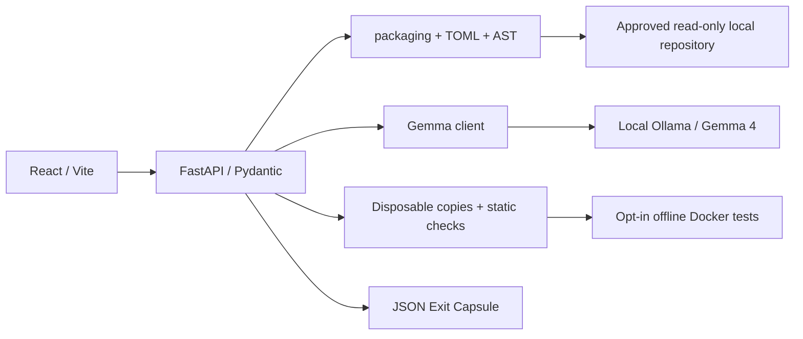

# DEPENDIQ

**AI-Powered Dependency Intelligence and Migration Assistant**

Local dependency evidence. Genuine Gemma 4 reasoning. Explicit verification boundaries. A portable Dependency Exit Capsule.

Hacktoberfest 2026 — Hackday Mumbai × ISTE KJSSE · Track 1: Gemma 4 — Dependency Resilience. Team member names must be filled in by the team before submission.

Python dependency declarations often drift between installers, and upgrading a package can break the APIs a project actually uses. DEPENDIQ connects manifest constraints to real source locations, asks a local model for migration guidance, and records what was actually checked. It never equates a recommendation with a successful migration.

## Quick start (macOS, Python 3.12 or 3.13, Node 20.19+)

```bash
git clone --branch astra-complete-build https://github.com/techwings0710/iste.git DEPENDIQ
cd DEPENDIQ
python3 -m venv .venv
source .venv/bin/activate
python -m pip install -r requirements-dev.txt
npm --prefix frontend ci
# Keep the analysis target OUTSIDE this repository.
git clone https://github.com/rishrek/LinkWatch.git ../LinkWatch
export DEPENDIQ_APPROVED_ROOTS="$(cd ../LinkWatch && pwd)"
export GEMMA_MODEL=gemma4:e2b
python -m uvicorn backend.main:app --host 127.0.0.1 --port 8000
```

In a second terminal:

```bash
cd DEPENDIQ
npm --prefix frontend run dev
```

Open **http://127.0.0.1:5173**. Enter the absolute LinkWatch path or click **Use approved path**. Scan, inspect evidence, generate migration guidance, compare an exact-version scenario, and download the capsule. Only the backend contacts Ollama. Without `DEPENDIQ_APPROVED_ROOTS`, only the bundled `samples/` directory is approved. That sample contains deliberately fictional dependencies and is labeled as a scanner fixture.

`.env.example` documents settings; environment files are **not automatically loaded**. Export the values in the backend terminal. Both servers bind loopback. This is a single-user local prototype; do not expose the API to a network or use multiple Uvicorn workers. Sessions live in memory and require rescanning after restart; `.dependiq/` stores ignored local evidence snapshots.

## Six capabilities

1. **Scan** requirements `.txt`/`.in`, recursive `-r` includes, PEP 621 dependencies and extras, and PEP 735 string groups. Normalize with `packaging`; evaluate markers in the backend environment.
2. **Trace** Python AST imports and aliases, affected-module test imports, and explicitly labeled textual configuration references. Each location includes a file, line, snippet, and mapping provenance. A repository can supply `dependiq-import-map.json`, for example `{"my-distribution": ["my_import"]}`.
3. **Reason** about flagged observations through real local Gemma 4 via Ollama, one dependency at a time. Pydantic validates every recommendation, with timeouts and one bounded retry for invalid JSON. Nothing generated by the model is executed.
4. **Verify** an explicit same-package exact-version migration in disposable copies. AST/constraint comparisons always run. Runtime tests require explicit trust, server opt-in, a prebuilt Docker image, and offline wheels. Unsupported or unavailable execution returns `NOT RUN` and its reason.
5. **Compare** baseline and migration commands, status, installation failures, test counts, outputs, and unresolved compatibility gaps. Counts remain null until real execution evidence exists.
6. **Preserve** observations, model recommendations, and actual execution outcomes in downloadable JSON. The API uses server-owned sessions so a client cannot forge capsule evidence.

## Architecture



```text
frontend/src/       React views, shared components, centralized API service
backend/           scanner, constraint reasoning, AST tracing, API, verification
ai/                local client, bounded prompts, strict recommendation schema
tests/             scanner, API, Gemma interface, verifier tests
samples/           labeled synthetic scanner fixture
capsules/          optional local exports (ignored)
docs/              evidence, API, model setup, verification, slides, demo, checklist
scripts/           live model check and reproducible API demonstration
```

Frontend: React, Vite, Tailwind CSS, Lucide, Motion. The dependency graph uses SVG from actual declarations. Animations honor reduced-motion preferences. No external fonts, images, analytics, cloud inference, or paid APIs are required at runtime.

## Gemma 4 setup

Install Ollama from the [official macOS download](https://ollama.com/download/mac), launch the app, or run its CLI service:

```bash
ollama serve
# In another terminal:
ollama pull gemma4:e2b
ollama list
ollama run gemma4:e2b "Reply with one short sentence about dependency migration."
curl http://localhost:11434/api/tags
```

Use the **exact installed local identifier** shown by `ollama list`:

```bash
export OLLAMA_BASE_URL=http://localhost:11434
export GEMMA_MODEL=gemma4:e2b
export GEMMA_TIMEOUT=120
# From the project root, with the Python environment activated:
python -m scripts.check_model /absolute/path/to/LinkWatch
```

The client rejects non-Gemma-4 identifiers and cloud tags. The backend sends an Ollama `/api/chat` request with `stream=false`, a JSON schema in `format`, and a bounded context/output budget. The response must validate against `ai.schemas.Recommendation`, including `verified=false`. Model digest, response model, access method, and inference status are recorded.

Gemma 4 is by Google DeepMind. Its [official model card](https://ai.google.dev/gemma/docs/core/model_card_4) identifies **Apache 2.0** licensing. Weights are obtained separately from the [official Ollama Gemma 4 library](https://ollama.com/library/gemma4); they are not redistributed here. Model role: interpret observed dependency risks and propose migration steps/tests; never decide test success. See [model setup and troubleshooting](docs/model-setup.md) and [recorded live inference](docs/live-gemma-evidence.json).

## Verification setup and trust boundary

A virtual environment is **not** a security sandbox. DEPENDIQ never runs target tests on the host. Docker execution is opt-in and uses network isolation, a read-only root/repository, non-root user, dropped capabilities, no new privileges, CPU/RAM/PID limits, temporary scratch storage, fixed argument arrays, and timeouts. It never mounts your home directory or Docker socket inside the container. Docker itself must already be running.

Prepare reviewed **binary wheels** in `wheelhouse/` and build [the verification image](docs/verification.Dockerfile). See [verification instructions](docs/verification.md) for exact commands and limitations. The backend does not pull images or download dependencies during verification.

```bash
export DEPENDIQ_ENABLE_EXECUTION=1
export DEPENDIQ_VERIFY_IMAGE=dependiq-verifier:local
# Restart the backend, inspect the target, acknowledge trust in the UI,
# select a dependency, enter an exact version, then Compare scenario.
```

Static checks are observations, not executed project tests. Installing dependencies and passing existing tests still cannot prove complete compatibility. Container support has unit coverage; real container execution was unavailable in the build environment. Consult [actual validation evidence](docs/validation.md).

## API

Interactive schemas: **http://127.0.0.1:8000/docs**. Details: [API contract](docs/api.md).

| Method | Endpoint | Body / result |
|---|---|---|
| GET | `/api/health` | Backend, approved paths, local model readiness |
| POST | `/api/scan` | `{ "repository_path": "/absolute/path" }` → `ScanResult` |
| POST | `/api/analyze` | Entire scan response → enriched canonical session |
| POST | `/api/verify` | `scan_id`, `dependency_name`, `proposed_version`, `trusted_repository` |
| POST | `/api/capsule` | `{ "scan_id": "…" }` → attachment JSON |

The scan ID is required for analysis, verification, and export. Extra client findings are ignored; the backend loads its original session. API errors contain actionable details. Model unavailability is a successful scan response with `ai_status=unavailable`, not fabricated guidance.

## Tests and reproducible demo

```bash
python -m pytest tests -q
npm --prefix frontend run build
# With backend + Ollama running:
python -m scripts.demo /absolute/path/to/LinkWatch --output capsules/linkwatch.json
```

Tests cover manifests, normalization, conflict reasoning, local version labels, AST locations and aliases, invalid files/paths, symlinks, empty inventories, markers/extras, API validation, unforgeable observations, offline models, malformed JSON, timeouts, subprocess errors, container argument restrictions, migration rewriting, and capsule structure. Mock AI fixtures are labeled as synthetic. See [validation](docs/validation.md) for actual results and verification gaps.

The committed [LinkWatch capsule](docs/linkwatch-exit-capsule.json) is a dated **example execution artifact**, not application seed data. The app always rescans a local checkout. Live Gemma output remains unverified advice.

## Capsule format

`schema_version`, `kind`, `generation`, `evidence_legend`, `scan`, `verification`, `open_concerns`, `limitations`. The scan holds inventory, declaration evidence, exact usage references, AI recommendations, model metadata and source fingerprint. Verification holds explicit scenario, changed files, static comparison, baseline/migration outcomes and compatibility gaps. Missing tests have null counts and `NOT RUN` reasons.

- `OBSERVED`: repository/manifest/AST facts within documented analysis limitations.
- `AI-SUGGESTED`: validated model output, always `verified=false`.
- `EXECUTION-VERIFIED`: an actual attempted command and its outcome; a failed command is not a compatibility success.

## Scope and limitations

- This is offline, direct-dependency analysis. No advisory database, release freshness claim, transitive resolver, or unsupported lockfile interpretation is invented.
- Exact pins and supported bounds can prove conflicts. Other complicated exclusions return uncertainty when no witness is found. A satisfying version is not proof that it exists on a registry.
- Runtime and development declarations are compared together; different installers may represent different intended environments. Extras are excluded from combined conflict proofs; markers use the backend Python version/platform.
- Dynamic imports, scope/shadowing, conditional imports, generated configuration, setup.py execution, Poetry semantics and advanced pip directives are not resolved. Errors are preserved.
- TOML evidence lines use literal matching; line 0 means unlocated. Multi-line/escaped declarations can remain uncertain.
- Scanning is restricted to approved roots, rejects symlink files/directories, excludes hidden/build/environment files, limits files to 2 MB and repositories to 10,000 regular files. Use stable inspected checkouts; this is not hardened against concurrent malicious filesystem mutation.
- Migration verification supports exact-version manifest edits, not AI-generated source patches or arbitrary commands. Offline wheel availability and original dependency incompatibilities can prevent tests.
- The optional container runner has not been demonstrated against a real Docker daemon in this environment. Browser visual QA could not run because no browser automation surface was available.
- Future improvements: complete PEP 440 solver, optional advisory snapshots, deeper import binding analysis, per-scenario locks, richer test selection, and registry-independent wheel provenance.

## Submission and collaboration

Delivery: [feature branch](https://github.com/techwings0710/iste/tree/astra-complete-build) · [PR #1](https://github.com/techwings0710/iste/pull/1), open for Integrator review. The Integrator created main from the initial implementation; this PR adds final fixes and documentation.

All build-agent commits were made on **astra-complete-build**. Never force-push, push directly to main, or merge your own delivery PR. The designated Integrator reviews and merges. No existing teammate work was present during repository inspection.

**Submission issues requiring organizer/Integrator confirmation:** current destination `techwings0710/iste` does not match `H26_TeamName_ProjectName`; the official starter-fork URL was not provided; team identities and official slide template remain to be supplied. Do not rename or claim starter provenance without confirmation. If main is absent, the Integrator must bootstrap it before a PR can target it.

[Six-slide content draft](docs/presentation-content.md) · [Two-minute demo](docs/demo-script.md) · [Submission checklist](docs/submission-checklist.md)

## License and acknowledgments

Project code: [MIT](LICENSE). Model weights retain their separate upstream terms. No organizer starter code was supplied to relicense. LinkWatch is the analysis target, cloned separately and never copied into this repository. Thanks to its authors, the hackathon organizers, Google DeepMind, Ollama, and the open-source projects listed in the dependency manifests. AI assistance was used to implement the project; the team must inspect and understand the code before submission.
